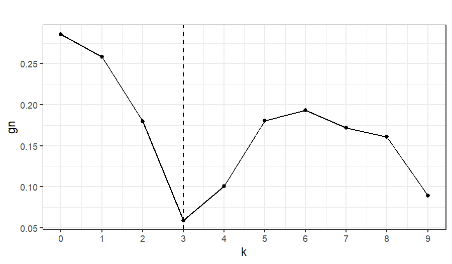

<!-- README.md is generated from README.Rmd. Please edit that file. -->

# ICtest

<!-- badges: start -->

[](https://CRAN.R-project.org/package=ICtest)
[](https://CRAN.R-project.org/package=ICtest)
[](https://CRAN.R-project.org/package=ICtest)
[](https://github.com/klauschN/ICtest/actions/workflows/R-CMD-check.yaml)
<!-- badges: end -->

In linear dimension reduction the data are transformed into components
of which only a few are assumed to carry the information of interest,
while the remaining ones are considered noise. What makes a component
interesting depends on the method. In principal component analysis (PCA)
these are the components with large variances, in independent component
analysis (ICA) and non-Gaussian component analysis (NGCA) the
non-Gaussian components, and in supervised dimension reduction such as
sliced inverse regression (SIR) the components which carry information
about the response. The package **ICtest** provides tests and estimates
for the number of these interesting, or informative, components, which
also explains its name.

## Main features

- Asymptotic tests for PCA (`PCAasymp()`, `PCAlrt()` and `PCAschott()`,
  the latter also for p \> n), for NGCA and ICA (`FOBIasymp()`) and for
  SIR (`SIRasymp()`).
- Bootstrap tests for the same models (`PCAboot()`, `FOBIboot()`,
  `ICSboot()` and `SIRboot()`) and a simulation-based test using
  non-Gaussian projection pursuit (`NGPPsim()`).
- `kSearch()`, which turns any of the tests into an estimate of the
  dimension using a forward, backward or binary search.
- Ladle estimators (`PCAladle()`, `FOBIladle()`, `SIRladle()` and the
  general `ladle()`) and predictor augmentation estimators (`PCAaug()`,
  `FOBIaug()` and `SIRaug()`), including the high-dimensional version
  `PCAaugHD()`.
- Plotting methods based on **graphics** and **ggplot2**, and the
  function `rorth()` for random orthogonal matrices that are uniformly
  distributed with respect to the Haar measure.

Note that `PCAlrt()`, `PCAaugHD()`, `FOBIaug()` and `SIRaug()` are so
far available only in the development version.

## Installation

The released version can be installed from CRAN:

``` r
install.packages("ICtest")
```

The development version can be installed from GitHub:

``` r
# install.packages("remotes")
remotes::install_github("klauschN/ICtest")
```

## Example

As an example we consider simulated data with three components whose
variances are larger than those of the remaining seven, rotated by a
random orthogonal matrix.

``` r
library(ICtest)
set.seed(1)
n <- 200
p <- 10
Z <- matrix(rnorm(n * p), ncol = p) %*% diag(c(3, 2.5, 2, rep(1, 7)))
X <- Z %*% t(rorth(p))
```

A forward search with the asymptotic test for subsphericity estimates
the number of interesting components.

``` r
kSearch(X, PCAasymp)
#> Results for estimated k = 3:
#> 
#>  PCA subsphericity test using cov
#> 
#> data:  X
#> T = 27.921, df = 27, p-value = 0.415
#> alternative hypothesis: the last 7 eigenvalues are not equal
#> 
#> Tested k values and respective p-values:
#> k = 0, p-value = < 2.2e-16
#> k = 1, p-value = < 2.2e-16
#> k = 2, p-value = < 2.2e-16
#> k = 3, p-value = 0.415
```

The ladle estimator gives the same answer, and its criterion can be
plotted with **ggplot2**.

``` r
pcaLadle <- PCAladle(X)
pcaLadle$k
#> [1] 3
ggladleplot(pcaLadle, main = "", xlab = "k") +
  geom_vline(xintercept = pcaLadle$k, linetype = "dashed") +
  scale_x_continuous(breaks = 0:(p - 1)) + theme_bw()
```



More examples are given in the vignettes, see
`vignette(package = "ICtest")`.

## References

The methods are described in the following papers, among others:

- Nordhausen, K., Oja, H. and Tyler, D.E. (2022). Asymptotic and
  bootstrap tests for subspace dimension. *Journal of Multivariate
  Analysis*, 188, 104830. <doi:10.1016/j.jmva.2021.104830>
- Nordhausen, K., Oja, H., Tyler, D.E. and Virta, J. (2017). Asymptotic
  and bootstrap tests for the dimension of the non-Gaussian subspace.
  *IEEE Signal Processing Letters*, 24, 887–891.
  <doi:10.1109/LSP.2017.2696880>
- Luo, W. and Li, B. (2016). Combining eigenvalues and variation of
  eigenvectors for order determination. *Biometrika*, 103, 875–887.
  <doi:10.1093/biomet/asw051>
- Luo, W. and Li, B. (2021). On order determination by predictor
  augmentation. *Biometrika*, 108, 557–574. <doi:10.1093/biomet/asaa077>
- Radojičić, U. and Virta, J. (2025). Dimension estimation in a spiked
  covariance model using high-dimensional data augmentation.
  *Biometrika*, 112, asaf052. <doi:10.1093/biomet/asaf052>

To cite the package itself, see `citation("ICtest")`. Bug reports and
suggestions are welcome as
[issues](https://github.com/klauschN/ICtest/issues).
